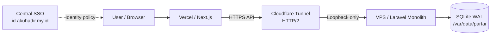

# PARTAI

> Infrastruktur digital civic-tech untuk mendidik, melayani, dan membantu warga mengawasi tata kelola partai.

[](https://github.com/bagusgrav/partai/actions/workflows/deploy-api.yml)
[](LICENSE)
[](https://nextjs.org/)
[](https://laravel.com/)

PARTAI (akuhadir.my.id) adalah aplikasi open-source untuk pendidikan kewargaan, partisipasi lapangan, akses informasi kesejahteraan, dan akuntabilitas internal. Aplikasi mendukung kerja dan pengawasan warga; ia tidak menggantikan proses demokratis, keputusan resmi pemerintah, atau verifikasi data oleh instansi yang berwenang.

## Mulai di sini

- [Panduan pengembangan lokal](#pengembangan-lokal)
- [Panduan kontribusi](CONTRIBUTING.md)
- [Blueprint arsitektur](docs/architecture.md)
- [Referensi API](docs/api-reference.md)
- [Panduan warga](docs/user-guide.md)
- [Roadmap](ROADMAP.md)
- [Aturan ekosistem](ECOSYSTEM.md)

## Fitur utama

Status di bawah merujuk pada fitur yang ditandai selesai di [ROADMAP.md](ROADMAP.md). Penyelesaian satu komponen tidak berarti seluruh fase sudah tuntas.

| Fase | Kemampuan yang tersedia | Catatan cakupan |
| --- | --- | --- |
| **1 — Pendidikan kewargaan** | Latihan kuis dengan pengulangan terjadwal SM-2; soal esai dan peer review; pembahasan; poin reputasi; daily digest. | Kurikulum penuh lima domain dan mastery/sertifikasi masih dalam roadmap. |
| **2 — Aksi lapangan** | Acara, QR dinamis, pemeriksaan geofence, klaim kehadiran, dan atestasi silang antar-cluster. | Sistem juri acak untuk mengaudit klaim belum lengkap. |
| **3 — Pengawasan data & kesejahteraan** | Ringkasan/wilayah data kesejahteraan, pipeline BPS/BNPB, indikator ekonomi, wawasan, dan pemeriksaan bansos “Jemput Hak”. | IKK kabupaten/kota serta kanal pelaporan tambahan masih dalam roadmap. |
| **4 — Tata kelola** | Panel sortisi berbasis mastery, voting, pengajuan dan voting recall, serta daftar publik Kontrak Faksi. | Voting parameter, panel etik/editorial, dan seluruh dasbor kontrak dewan masih dalam roadmap. |

## Arsitektur singkat

Frontend Next.js dilayani melalui Vercel. Permintaan API menuju Laravel di VPS melalui Cloudflare Tunnel `protocol: http2`; SQLite WAL berada di `/var/data/partai/database.sqlite` pada deployment sesuai panduan. Model aplikasi adalah **Laravel modular monolith**, bukan layanan backend terpisah per fitur.



Diagram menunjukkan batas arsitektur dan kebijakan identitas. Rute API saat ini masih mencakup sesi tamu dan pendaftaran anggota; status kesenjangan SSO dan batas operasional lain dijelaskan di [architecture](docs/architecture.md).

## Teknologi

| Lapisan | Teknologi |
| --- | --- |
| Web | Next.js 16 App Router, React, Tailwind CSS |
| API | Laravel 13, PHP 8.3+, Sanctum |
| Data | SQLite, WAL, foreign keys, busy timeout |
| Deployment | Vercel, VPS, Cloudflare Tunnel HTTP/2 |
| Integrasi | API JSON; permintaan mutasi idempoten memakai `request_id` sesuai endpoint |

Arsitektur rinci, SSO, kebijakan Single Door, dan batas memori dijelaskan di [docs/architecture.md](docs/architecture.md). Kontrak integrasi antar-aplikasi ada di [ECOSYSTEM.md](ECOSYSTEM.md).

## Pengembangan lokal

### Prasyarat

- PHP 8.3 atau lebih baru dan Composer
- Node.js 20 atau lebih baru dan npm
- Git

### API Laravel

```powershell
cd api
composer install
Copy-Item .env.example .env
php artisan key:generate
New-Item -ItemType File -Force database\database.sqlite
php artisan migrate --seed
php artisan serve
```

API lokal tersedia di `http://127.0.0.1:8000/api`.

### Frontend Next.js

Buka terminal baru dari root repository:

```powershell
cd web
npm install
```

Untuk memakai API lokal, atur `web/.env.local`:

```dotenv
NEXT_PUBLIC_API_URL=http://127.0.0.1:8000/api
```

Lalu jalankan:

```powershell
npm run dev
```

Frontend tersedia di `http://localhost:3000`.

### Pemeriksaan

```powershell
cd api
php artisan test
cd ..\web
npm run lint
npm run build
```

Lihat [docs/deployment.md](docs/deployment.md) untuk deployment VPS/Vercel. Jangan menaruh `.env`, token, kunci, atau data warga produksi di repository.

## Keamanan dan data warga

- Pemeriksaan bantuan sosial hanya dapat meminta NIK milik akun yang sedang terautentikasi; data NIK bersifat pribadi dan respons tidak boleh disimpan di cache publik.
- Hasil “Jemput Hak” mengikuti dataset yang tersedia dan bukan penetapan resmi penerima bantuan.
- Perubahan data harus tervalidasi, berotorisasi, tercatat bila sesuai, dan mengikuti aturan idempotensi. Jangan memasukkan kredensial atau data pribadi ke log, issue, maupun contoh dokumentasi.
- Laporkan dugaan kerentanan secara privat kepada maintainer, bukan melalui issue publik.

## Lisensi

PARTAI dirilis dengan [MIT License](LICENSE).
