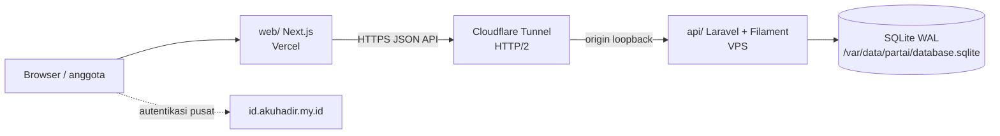

# PARTAI

> Infrastruktur civic-tech untuk mendidik, melayani, dan membantu warga mengawasi tata kelola partai politik secara terbuka.

[](https://github.com/bagusgrav/partai/actions/workflows/deploy-api.yml)
[](LICENSE)
[](https://nextjs.org/)
[](https://laravel.com/)

PARTAI (`akuhadir.my.id`) adalah perangkat lunak bebas untuk pendidikan kewargaan, partisipasi anggota, akses informasi kesejahteraan, dan akuntabilitas internal. Proyek ini menerjemahkan prinsip tata kelola menjadi aturan, data, dan alur yang dapat diperiksa—**Constitution as Code**. Aplikasi membantu warga bekerja dan mengawasi; ia tidak menggantikan pemilu, keputusan resmi pemerintah, atau verifikasi instansi berwenang.

## Visi dan latar belakang

Kepercayaan pada partai politik melemah ketika keputusan, rekrutmen, pendanaan, dan pengawasan tertutup di sekitar segelintir elite. PARTAI dirancang untuk membuat proses organisasi lebih terbuka, dapat ditelusuri, dan mudah diaudit oleh anggota maupun publik—tanpa menjadikan popularitas, kekayaan, atau banyaknya aktivitas sebagai hak suara tambahan.

Platform ini mendukung delapan fungsi partai ideal sebagai kerangka kerja digital:

1. Pendidikan dan sosialisasi politik berbasis kurikulum kewargaan.
2. Menyerap dan menyalurkan aspirasi anggota serta masyarakat.
3. Mengagregasi kepentingan menjadi agenda dan usulan kebijakan.
4. Menyediakan komunikasi politik yang terbuka dan dapat diperiksa.
5. Memperluas partisipasi melalui kegiatan lapangan maupun kontribusi asinkron.
6. Mengembangkan rekrutmen dan kapasitas kepemimpinan berdasarkan ambang kompetensi.
7. Mendorong integrasi, musyawarah, dan penyelesaian konflik secara tertib.
8. Mengawasi kekuasaan, janji publik, dan penggunaan sumber daya.

Daftar tersebut adalah kerangka produk PARTAI, bukan pengganti rumusan hukum. Informasi warga tetap diperlakukan secara privat, dan data publik tidak dipresentasikan sebagai keputusan resmi pemerintah.

## Prinsip tata kelola anti-oligarki

### Empat lapis pemisahan kekuasaan

| Lapis | Peran | Batas |
| --- | --- | --- |
| **1. Anggota** | Pemegang kedaulatan organisasi; satu anggota, satu suara. | Skor, jabatan, dan jumlah kontribusi tidak menambah bobot suara. |
| **2. Mandat representatif** | Pengurus dan wakil menjalankan keputusan anggota dengan mandat serta Kontrak Faksi yang dapat dipantau. | Mandat dibatasi aturan, waktu, transparansi, dan mekanisme recall. |
| **3. Pengawasan independen** | Panel audit/etik memeriksa klaim dan proses; komposisi panel ditujukan untuk dipilih melalui sortisi. | Panel tidak mengambil alih hak suara anggota atau menjalankan fungsi eksekutif. |
| **4. Akuntabilitas publik** | Data, alasan keputusan, bukti, dan hasil pemeriksaan dapat ditinjau sesuai batas privasi. | Data sensitif dan identitas warga tidak dibuka demi transparansi semu. |

Pemisahan ini adalah prinsip desain; tidak semua lapis dan proses telah diimplementasikan penuh.

### Mastery Score terpisah dari Participation Score

- **Mastery Score (0–100 per domain)** mengukur penguasaan materi kewargaan pada `hak_konstitusional`, `alasan_bernegara`, `keuangan_negara`, `hukum`, dan `politik_bernegara`. Rata-rata domain membentuk level 1–4. Level 4 (rata-rata minimal 80) menjadi ambang absolut untuk Panel Audit, Panel Etik, dan Bakal Caleg—bukan peringkat relatif.
- **Participation Score (poin kumulatif)** mencatat kontribusi yang telah diverifikasi, baik lapangan maupun non-fisik: riset, bantuan hukum, logistik, editorial, dan kerja asinkron. Kategori tersebut memiliki bobot poin yang setara.
- Kedua skor disimpan dan dihitung terpisah. Participation Score **tidak memengaruhi hak suara**; prinsipnya selalu satu anggota, satu suara.
- Koreksi skor menambah entri audit baru. Riwayat tidak diedit atau dihapus.

### Sortisi dan perwalian teknis

Sortisi yang dituju memakai seed publik yang diumumkan sebelum undian dan algoritma yang dapat direproduksi sesudahnya. Kriteria kelayakan, snapshot peserta, seed, dan hasil perlu dipublikasikan dalam bentuk yang dapat diaudit tanpa mengekspos data pribadi.

Perwalian teknis bukan mandat politik: kewenangan sementara memiliki **sunset clause dua tahun** dan pemulihan/perubahan kritis memerlukan **multi-signature 3-of-3**. Prinsip ini merupakan sasaran tata kelola; status tiap kontrol tercatat di [ROADMAP.md](ROADMAP.md), bukan diasumsikan sudah aktif hanya karena tercantum di dokumentasi.

## Peta fitur dan status implementasi

“Tersedia di kode” berarti rute atau halaman ada di repo; status deployment dan kelengkapan seluruh proses tata kelola dapat berbeda.

| Modul | Route | Status dan batas |
| --- | --- | --- |
| Data publik | [`/data`](web/src/app/data) | Dasbor data kesejahteraan dan ringkasan wilayah. Dataset dan indikator mengikuti sumber yang tersedia. |
| Kegiatan warga | [`/events`](web/src/app/events) | Daftar/kegiatan, klaim kehadiran, QR dan atestasi silang. Sortisi audit penuh masih dalam roadmap. |
| Jemput Hak | [`/jemput-hak`](web/src/app/jemput-hak) | Pemeriksaan program bantuan untuk akun terautentikasi; hasil bukan penetapan penerima resmi. |
| Kontrak Faksi | [`/kontrak-faksi`](web/src/app/kontrak-faksi) | Daftar publik janji dan status; cakupan data bergantung pada entri yang tersedia. |
| Tanya Jawab | [`/tanya-jawab`](web/src/app/tanya-jawab) | FAQ terpublikasi dan pengiriman pertanyaan untuk ditinjau pengurus. |
| Reputasi | [`/reputasi`](web/src/app/reputasi) | Statistik anonim, simulator ambang kelayakan, API dua skor terpisah, dan ledger audit. Verifikasi asesmen/mastery operasional penuh masih berkembang. |

### Roadmap berikutnya

- Menuntaskan kurikulum lima domain, asesmen mastery, dan sertifikasi level 1–4.
- Menghubungkan hasil asesmen resmi ke ledger mastery tanpa mencampur poin partisipasi.
- Menerapkan sortisi ber-seed publik, panel etik/editorial, dan proses audit klaim.
- Memperluas dashboard kontrak, indikator kesejahteraan daerah, serta voting kebijakan.
- Menyelaraskan alur identitas dan token dengan SSO pusat.

Rincian fase dan status terkini ada di [ROADMAP.md](ROADMAP.md).

## Arsitektur teknis

Repositori ini adalah monorepo dua aplikasi. API merupakan **Laravel modular monolith**, bukan sekumpulan microservice. Frontend Next.js berkomunikasi dengan API melalui HTTPS; akses publik ke origin API mengikuti Single Door melalui Cloudflare Tunnel.



| Komponen | Tanggung jawab |
| --- | --- |
| `web/` | Next.js App Router, UI warga, dan API client berbasis `fetchWithRetry`. Deploy frontend melalui Vercel. |
| `api/` | Laravel API, autentikasi token legacy, logika domain, migrasi, tes, dan panel back-office Filament. Deploy pada VPS di belakang Tunnel. |
| `data/` | Dataset kurikulum per domain. |
| `docs/` | Referensi API, arsitektur, deployment, desain, dan panduan pengguna. |
| `SQLite` | Database operasional di `/var/data/partai/`, dengan WAL, foreign keys, `synchronous=NORMAL`, dan busy timeout. Berkas database berada di luar working tree. |
| `id.akuhadir.my.id` | Pintu masuk SSO pusat. UI mengarahkan pengguna ke SSO dan tidak menyediakan form login lokal. Endpoint guest/registrasi lama di API masih tercatat sebagai pekerjaan penyelarasan. |

Mutation API menggunakan UUID `request_id`, replay aman untuk payload yang sama, konflik `409` untuk penggunaan ulang ID dengan payload berbeda, dan rate limit sesuai jenis operasi. Tabel baru memakai primary key UUID. Perubahan data anggota harus berotorisasi dan tercatat; data publik tidak boleh memuat identitas atau NIK.

Rujukan lebih rinci: [arsitektur](docs/architecture.md), [deployment](docs/deployment.md), [referensi API](docs/api-reference.md), dan [kontrak ekosistem](ECOSYSTEM.md).

## Teknologi

| Lapisan | Teknologi |
| --- | --- |
| Web | Next.js 16 App Router, React, TypeScript, Tailwind CSS |
| API | Laravel 13, PHP 8.3+, Sanctum, Filament 3 |
| Otorisasi | `spatie/laravel-permission`; role panel `super_admin`, `pengurus`, `panelis` |
| Data | SQLite WAL, UUID, foreign keys |
| Hosting | Vercel, VPS, Cloudflare Tunnel HTTP/2 |
| Lisensi | GNU Affero General Public License v3.0 (AGPL-3.0) |

## Pengembangan lokal

### Prasyarat

- PHP 8.3+ dan Composer
- Node.js 20+ dan npm
- Git

### API Laravel

Jalankan dari PowerShell di root repo:

```powershell
Set-Location api
composer install
Copy-Item .env.example .env
php artisan key:generate
New-Item -ItemType File -Force database\database.sqlite
php artisan migrate --seed
php artisan serve
```

API lokal tersedia di `http://127.0.0.1:8000/api`. File `.env` dan database SQLite lokal diabaikan Git.

### Frontend Next.js

Buka terminal baru dari root:

```powershell
Set-Location web
npm install
```

Untuk memakai API lokal, buat `web/.env.local`:

```dotenv
NEXT_PUBLIC_API_URL=http://127.0.0.1:8000/api
```

Lalu jalankan:

```powershell
npm run dev
```

Frontend tersedia di `http://localhost:3000`.

### Pemeriksaan

```powershell
Set-Location api
php artisan test
php vendor\bin\pint --test

Set-Location ..\web
npm run lint
npm run build
```

## Kontribusi terbuka

Mulai dengan [CONTRIBUTING.md](CONTRIBUTING.md), [ROADMAP.md](ROADMAP.md), serta dokumentasi modul yang terkait. Untuk perubahan kode:

1. Buat branch terarah dan perubahan sekecil mungkin.
2. Ikuti pola proyek: UUID untuk tabel baru, `request_id` UUID dan rate limit untuk operasi POST, `fetchWithRetry` untuk setiap panggilan API web, serta RBAC melalui role yang telah ditetapkan.
3. Tambahkan atau ubah tes untuk perilaku dan kegagalan penting; perbarui dokumentasi kontrak saat rute/payload berubah.
4. Jalankan tes, Pint, lint, atau build yang sesuai; jelaskan hasil dan risiko migrasi di pull request.
5. Jangan commit `.env`, kredensial, token, database lokal/produksi, NIK, atau data pribadi. Jangan membuat form login lokal; autentikasi pengguna diarahkan ke SSO pusat.

Laporkan isu keamanan secara privat kepada maintainer, bukan melalui issue publik.

## Lisensi

PARTAI dilisensikan di bawah [GNU Affero General Public License v3.0](LICENSE).
