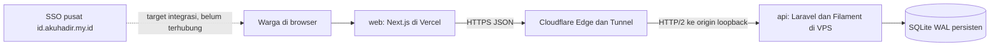

# PARTAI

> Infrastruktur civic-tech untuk pendidikan kewargaan, partisipasi warga, akses informasi kesejahteraan, dan akuntabilitas tata kelola partai politik.

[](LICENSE)
[](https://nextjs.org/)
[](https://laravel.com/)

PARTAI (`akuhadir.my.id`) adalah aplikasi sumber terbuka untuk membuat proses pendidikan, kegiatan, data publik, dan tata kelola organisasi lebih mudah ditinjau. Gagasan **Constitution as Code** berarti aturan dan alur dapat diperiksa sebagai perangkat lunak; ini bukan klaim bahwa semua mekanisme tata kelola telah dilaksanakan atau diaudit secara independen.

Platform membantu warga belajar, berpartisipasi, dan memeriksa informasi yang tersedia. PARTAI **bukan** penentu resmi kelayakan bantuan pemerintah, pengganti lembaga pemilu atau pemerintah, dan bukan sumber kebenaran untuk data yang belum diverifikasi oleh instansi terkait.

## Status dan batas klaim

Ringkasan status umum ini didasarkan pada audit repository di commit `a8a501af36c0e56878655a671505ed3eafe64bb5` pada 19 November 2026. Baris Komunitas ditambahkan setelah implementasi dan tes fitur backend lulus. Keberadaan route, service, workflow, atau tes berarti tersedia di repo; hal itu **tidak membuktikan** fitur telah di-deploy, dipakai dengan data nyata, atau lulus verifikasi produksi.

Gunakan label status berikut saat membaca peta fitur:

- **Ada di kode**: halaman, route API, model, atau service ditemukan di repo.
- **Roadmap**: tercatat sebagai pekerjaan yang belum selesai di [ROADMAP.md](ROADMAP.md).
- **Deployment belum terverifikasi**: repo memiliki instruksi atau automation, tetapi tidak membuktikan hostname, server, secrets, jadwal, atau deployment aktif.
- **Belum terverifikasi**: tidak cukup bukti dari repository untuk menyimpulkan perilaku operasional.

## Visi, prinsip, dan ruang lingkup

Delapan fungsi produk yang menjadi arah PARTAI adalah pendidikan dan sosialisasi politik, penyaluran aspirasi, agregasi kepentingan, komunikasi terbuka, partisipasi, pengembangan kapasitas, musyawarah/penyelesaian konflik, dan pengawasan kekuasaan serta sumber daya.

Prinsip desain yang tercermin dalam kode dan dokumen:

- Hak suara tidak ditentukan oleh skor, jabatan, atau jumlah kontribusi; sasaran tata kelolanya adalah satu anggota, satu suara.
- **Mastery** (pemahaman materi) dan **participation** (kontribusi) dihitung sebagai ukuran terpisah. Kode memiliki service dan ledger terpisah; kelengkapan proses asesmen/sertifikasi tetap perlu dilihat di roadmap.
- Data sensitif bukan harga transparansi. Hasil bansos, data ekonomi, klaim kehadiran, dan status kontrak hanya seakurat dataset yang dipakai dan tidak otomatis merupakan verifikasi resmi.
- Laravel adalah modular monolith, bukan kumpulan microservice. Perubahan deployment, identitas, penyimpanan, dan kontrak API harus menjaga batas yang dijelaskan di [docs/architecture.md](docs/architecture.md).

## Peta fitur

Tabel ini menunjukkan rute yang ada di frontend dan status yang bisa disimpulkan dari repository. Status deployment semua fitur **belum terverifikasi**.

| Area | Route frontend | Bukti kode / status |
| --- | --- | --- |
| Beranda dan informasi | `/`, `/info`, `/info-indonesia`, `/data`, `/manifesto` | Halaman tersedia di [`web/src/app/`](web/src/app/); API data publik antara lain `/api/welfare/*`, `/api/economic/*`, `/api/insights/*`. |
| Pendidikan dan panduan | `/belajar`, `/review`, `/panduan`, `/glosarium` | Halaman dan API pendidikan/review/glosarium tersedia; tingkat penyelesaian kurikulum ada di [ROADMAP.md](ROADMAP.md). |
| Kegiatan dan reputasi | `/events`, `/events/[id]/qr`, `/events/[id]/claim`, `/events/[id]/attest`, `/reputasi` | Route UI, API event/attendance, service reputasi, dan ledger ada di kode. Sortisi ber-seed publik masih roadmap. |
| Transparansi dan layanan | `/jemput-hak`, `/kontrak-faksi`, `/pengawasan-birokrasi`, `/tanya-jawab` | Route dan API terkait tersedia. Data bansos adalah data aplikasi, bukan keputusan resmi; validitas sumber dan deployment belum terverifikasi. |
| Tata kelola | `/voting`, `/recall`, `/tata-kelola`, `/peta-jalan` | Ada halaman dan API untuk voting, recall, struktur/kelayakan organisasi. Sortisi yang dapat direproduksi dan beberapa mekanisme tata kelola masih roadmap. |
| Komunitas | `/komunitas` | **Ada di kode**: feed teks publik/anggota, komposer dengan `request_id`, feed cursor-based, pelaporan, dan moderasi Filament. Tes backend fitur lulus; deployment belum diverifikasi. |
| Akun | `/daftar`, `/auth/register`, `/masuk`, `/lupa-password`, `/reset-password`, `/profil`, `/notifikasi` | UI dan API pendaftaran, login email/password, sesi tamu, reset password, dan profil tersedia. Integrasi SSO pusat end-to-end **tidak ditemukan**. |

Daftar file halaman tersedia di [`web/src/app/`](web/src/app/). Definisi endpoint kanonis berada di [`api/routes/api.php`](api/routes/api.php); ringkasan route di [docs/api-reference.md](docs/api-reference.md) perlu dibandingkan dengan file tersebut karena dapat tertinggal.

### Otentikasi: penting

SSO pusat `id.akuhadir.my.id` adalah arah/invarian integrasi pada [ECOSYSTEM.md](ECOSYSTEM.md), tetapi implementasi repository saat ini tidak menunjukkan callback atau pertukaran token SSO. Sebaliknya, route `/masuk` memanggil endpoint API `/api/auth/login` dengan email dan password; `/daftar` memanggil `/api/auth/register`; frontend juga meminta token tamu dari `/api/auth/guest`. Rute dan halaman itu nyata di kode, sehingga pernyataan lama bahwa tidak ada login lokal tidak akurat. Jangan menganggap sesi lokal terhubung ke SSO atau menambahkan integrasi SSO tanpa kontrak IdP yang tervalidasi. Lihat bagian auth di [blueprint arsitektur](docs/architecture.md).

## Arsitektur ringkas



Komponen API menggunakan satu database SQLite operasional dan meng-host API JSON serta panel Filament. Tunnel dan VPS adalah topologi yang ditetapkan konfigurasi/panduan, bukan bukti server saat ini dapat diakses.

## Teknologi

| Lapisan | Teknologi di manifest/config |
| --- | --- |
| Web | Next.js `16.4.6`, React `19.3.0`, TypeScript, Tailwind CSS 4 |
| API | Laravel `^13.17`, PHP `^8.3`, Sanctum `^4`, Filament `^3.2`, Spatie Laravel Permission `^8.5` |
| Penyimpanan | SQLite; konfigurasi aplikasi mengaktifkan WAL, `synchronous=NORMAL`, foreign keys, dan `busy_timeout=5000` |
| Operasi yang dituju | Vercel untuk web; VPS + Cloudflare Tunnel HTTP/2 untuk API; data SQLite persisten di luar direktori kode |
| Lisensi | GNU Affero General Public License v3.0 atau lebih baru; lihat [LICENSE](LICENSE) |

Versi web di atas dibaca dari [`web/package.json`](web/package.json); batas versi API dari [`api/composer.json`](api/composer.json). Detail komponen, batas deployment, dan gap ada di [docs/architecture.md](docs/architecture.md).

## Quickstart lokal

Perintah berikut adalah panduan setup lokal baru, bukan sesuatu yang dijalankan oleh audit. Jangan gunakan terhadap database produksi. Prasyarat: PHP 8.3+, Composer, Node.js 20+ (gunakan versi yang didukung Next.js 16), npm, dan Git.

### 1. Jalankan API Laravel

Buka PowerShell di root repository:

```powershell
Set-Location api
composer install
Copy-Item .env.example .env
php artisan key:generate
if (-not (Test-Path database\database.sqlite)) {
    New-Item -ItemType File database\database.sqlite | Out-Null
}
php artisan migrate --seed
php artisan serve
```

API lokal menggunakan prefix `http://127.0.0.1:8000/api`; health route Laravel adalah `http://127.0.0.1:8000/up`. [`.env.example`](api/.env.example) mengatur SQLite secara default. Seeder menambahkan data demonstrasi, termasuk profil bansos simulasi. `RoleSeeder` juga membuat akun admin lokal dengan password fallback `password`; jangan gunakan kredensial development di luar lingkungan lokal. Gunakan hanya database lokal yang dibuat untuk pengembangan; jangan memasukkan NIK atau data pribadi nyata.

Variabel yang umum diperlukan (nama saja; jangan menaruh nilai rahasia di dokumen atau repository):

| Variabel | Penggunaan |
| --- | --- |
| `NEXT_PUBLIC_API_URL` | Base URL API yang dipakai web; default lokal ditunjukkan pada contoh di atas. Nilainya publik, bukan tempat menyimpan secret. |
| `APP_KEY`, `APP_ENV`, `APP_DEBUG` | Kunci dan mode Laravel. Buat key per lingkungan; gunakan `APP_DEBUG=false` di production. |
| `DB_CONNECTION`, `DB_DATABASE` | Driver dan path database. SQLite dipakai lokal; deployment guide menentukan file produksi di luar checkout. |
| `MAIL_*` | Konfigurasi pengiriman email verifikasi/reset. Mailer lokal dan transport production harus dibedakan. |
| `BPS_API_KEY`, `BNPB_API_KEY` | Kredensial opsional untuk sumber data; simpan di secret store, jangan commit atau bagikan. |
| `BPS_IKK_DATA_URL`, `BNPB_CKAN_DATA_URL`, `BNPB_CKAN_RESOURCE_ID` | Endpoint/resource opsional untuk ingest data IKK; format harus sesuai adapter kode. |

Untuk konfigurasi mail lokal dan variabel lain, periksa [`api/.env.example`](api/.env.example). Pengiriman email reset/verifikasi production memerlukan transport email yang benar.

### 2. Jalankan web Next.js

Buka terminal PowerShell kedua dari root:

```powershell
Set-Location web
npm install
@'
NEXT_PUBLIC_API_URL=http://127.0.0.1:8000/api
'@ | Set-Content .env.local
npm run dev
```

Web tersedia di `http://localhost:3000`. Jika API berjalan di origin lain, sesuaikan CORS Laravel dan `NEXT_PUBLIC_API_URL`; jangan memasukkan kredensial atau token ke variabel `NEXT_PUBLIC_*` karena nilainya dikirim ke browser.

## Pemeriksaan

Jalankan sesuai bagian yang diubah. Perintah ini tercantum di manifest dan dokumentasi kontribusi; hasil tes/build saat audit ini **tidak diklaim**.

```powershell
# API — dari api/
php artisan test
php vendor\bin\pint --test

# Web — dari web/
npm run lint
npm run build
npm run test:e2e
```

Suite API berada di [`api/tests/`](api/tests/), sedangkan tes browser Playwright ada di [`web/tests/`](web/tests/). Tes membutuhkan dependency yang sudah terpasang dan konfigurasi lokal yang sesuai; [`api/phpunit.xml`](api/phpunit.xml) mengatur database pengujian ke SQLite `:memory:`.

## Deployment

Repository berisi workflow [`deploy-api.yml`](.github/workflows/deploy-api.yml), [`api/deploy.sh`](api/deploy.sh), [`web/vercel.json`](web/vercel.json), konfigurasi Tunnel, dan [panduan deployment](docs/deployment.md). Keberadaan file tersebut hanya membuktikan ada definisi automation/panduan; domain, secrets, cron, Tunnel, Vercel project, backup, dan deployment aktif **belum diverifikasi**.

Perhatikan ketidaksesuaian dokumen operasi: workflow mengeksekusi `api/deploy.sh`; skrip mengasumsikan `/var/www/thortech/partai`, menjalankan `git reset --hard origin/main`, migrasi paksa, lalu reload `php8.4-fpm`. Sebaliknya, [docs/github-actions.md](docs/github-actions.md) menyebut path, user, dan versi service berbeda. Verifikasi konfigurasi server dan rekonsiliasi panduan sebelum deploy; jangan menafsirkan README ini sebagai persetujuan untuk menjalankan skrip.

## Kontribusi dan invariant

Mulai dari [CONTRIBUTING.md](CONTRIBUTING.md), [ROADMAP.md](ROADMAP.md), [docs/api-reference.md](docs/api-reference.md), dan [docs/architecture.md](docs/architecture.md). [ARCHITECTURE.md](ARCHITECTURE.md) adalah pointer root ke blueprint kanonis; [MEMORY.md](MEMORY.md) merangkum invariant, keputusan, dan serah-terima sesi. Perubahan yang menyentuh perilaku perlu tes yang sesuai serta pembaruan kontrak/dokumen.

- Pertahankan Laravel sebagai modular monolith dan satu pintu ingress API.
- Gunakan UUID untuk identitas data baru bila tidak ada alasan kompatibilitas lain.
- Ikuti kontrak per endpoint untuk `request_id`, replay, konflik `409`, otorisasi, dan rate limit. Tidak semua route POST adalah mutasi bisnis dengan kontrak yang sama.
- Semua panggilan jaringan API web memakai helper `fetchWithRetry` di [`web/src/lib/api/client.ts`](web/src/lib/api/client.ts), lalu memeriksa status HTTP secara eksplisit. Retry operasi tulis harus memakai ID dan payload yang sama.
- Jangan menganggap invarian SSO sudah diterapkan: endpoint login lokal masih tersedia dan harus diperlakukan sebagai gap arsitektur.
- Jaga database SQLite produksi di lokasi persisten di luar source checkout; buat backup konsisten sebelum migrasi berisiko.
- Jangan commit `.env`, kredensial, token, database, NIK, maupun data pribadi; jangan gunakan data pribadi nyata di contoh, log, issue, atau screenshot.

## Keamanan dan privasi

- **Dilarang menggunakan NIK/data pribadi nyata** dalam seed, fixture, screenshot, log, dokumentasi contoh, atau issue publik. Dataset seeder bansos menggunakan nilai simulasi; jangan menggantinya dengan data orang nyata.
- Model [`User`](api/app/Models/User.php) mengenkripsi atribut `nik` dan menyimpan hash untuk lookup melalui migrasi [`encrypt_user_nik`](api/database/migrations/2026_11_18_000000_encrypt_user_nik.php). Namun, tabel `social_assistances` mendefinisikan NIK sebagai kolom teks biasa pada migrasi [`create_social_assistances_table`](api/database/migrations/2026_11_17_060000_create_social_assistances_table.php). Endpoint `/api/rights/check` mengambil NIK secara implisit dari user yang terautentikasi, sehingga NIK tidak dikirim pada URL. Jangan menyimpulkan seluruh penyimpanan NIK sudah terenkripsi.
- Pemeriksaan `/api/rights/check` hanya memakai NIK akun yang sedang terautentikasi setelah `super_admin` menandai verifikasi pada Filament. Penanda ini dicatat pada `users.nik_verified_at`; jika masih `NULL` (termasuk untuk akun lama), endpoint menolak pemeriksaan dengan `403 nik_not_verified`. Memiliki NIK tersimpan tidak dengan sendirinya berarti NIK telah diverifikasi.
- Jangan pernah menaruh secret di `NEXT_PUBLIC_*`, URL, query string, log, atau repository. Konfigurasi backend gunakan `.env` lokal/secret store deployment.
- Laporkan dugaan kerentanan atau kebocoran data secara privat kepada maintainer, bukan sebagai issue publik. Lihat [CONTRIBUTING.md](CONTRIBUTING.md).

## Lisensi

PARTAI dilisensikan berdasarkan [GNU Affero General Public License v3.0 atau lebih baru](LICENSE).
