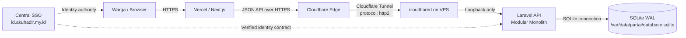
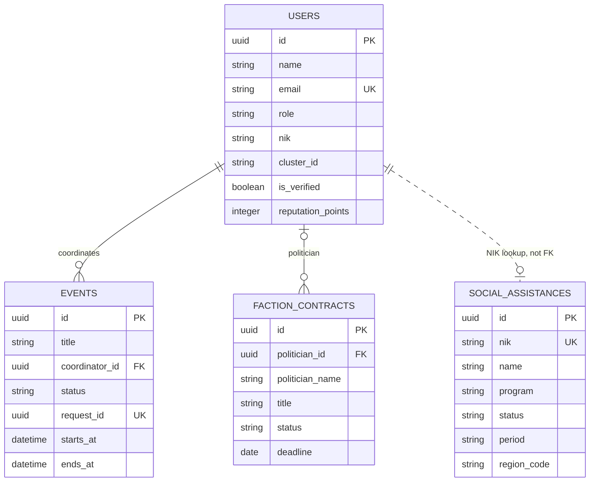

# Blueprint Arsitektur PARTAI

Dokumen ini menggambarkan arsitektur berjalan dan aturan target Thortech v2.0. Jika keduanya berbeda, bagian **Kesenjangan implementasi** menyatakan perbedaannya secara eksplisit; dokumentasi ini tidak mengubah perilaku runtime.

## Prinsip arsitektur

- **Hub-and-spoke pada tingkat deployment, monolith pada backend:** Vercel/Next.js dan integrasi eksternal menjadi konsumen API; satu Laravel modular monolith adalah hub aplikasi dan aturan domain. Modul bukan microservice dan berbagi satu database SQLite.
- **Single Door Policy:** trafik publik menuju satu hostname API Cloudflare Tunnel. Tunnel memakai `protocol: http2` dan meneruskan ke origin loopback; port backend tidak dibuka langsung.
- **SSO terpusat:** `id.akuhadir.my.id` adalah authority identitas sesuai standar. Backend hanya menerima identitas/kredensial yang sudah diverifikasi dan membatasi akses berdasarkan role serta kepemilikan.
- **SQLite WAL persisten:** database di `/var/data/partai/database.sqlite`, terpisah dari kode aplikasi dan penyimpanan sementara.
- **Idempotensi:** mutasi baru membawa UUID `request_id`; retry dengan ID/payload sama tidak membuat efek ganda.
- **Zero-RAM:** sasaran footprint rendah, bukan konsumsi memori nol. Aplikasi memakai memori proses dan SQLite memiliki cache/temp-store; jangan menafsirkan istilah ini sebagai jaminan teknis nol RAM.

## Alur data dan batas jaringan

**Alur target:** browser memakai frontend Vercel; request API melewati hostname publik Cloudflare, Tunnel HTTP/2, dan origin lokal sampai ke Laravel. Laravel memvalidasi autentikasi/otorisasi, menjalankan aturan domain, lalu membaca atau menulis SQLite. Penyedia identitas pusat adalah otoritas SSO; frontend tidak mengelola password akun lokal.

Cloudflare Tunnel pada [docs/cloudflared-config.yml](cloudflared-config.yml) menetapkan protokol HTTP/2 dan service lokal `http://127.0.0.1:8000`. Konfigurasi Nginx/PHP-FPM rinci ada di [docs/deployment.md](deployment.md).

## Hub-and-spoke / Laravel monolith

| Komponen | Tanggung jawab |
| --- | --- |
| Next.js pada Vercel | UI warga, dashboard, navigasi, dan pemanggilan API melalui helper frontend. |
| Cloudflare Tunnel | Satu jalur ingress dari hostname publik ke service lokal; tidak menjadi tempat aturan bisnis. |
| Laravel API | Autentikasi bearer, validasi input, role, aturan domain, idempotensi, dan pengendalian respons. |
| SQLite | Penyimpanan relasional untuk akun, kegiatan, data bantuan, kontrak, dan domain lainnya. |
| SSO pusat | Authority identitas lintas aplikasi; keputusan issuer/audience/validasi token harus mengikuti kontrak resmi IdP. |

Fitur pendidikan, kegiatan, kesejahteraan, reputasi, voting, recall, dan kontrak adalah modul dalam satu aplikasi Laravel. Integrasi BPS/BNPB serta data ekonomi/berita masuk melalui pekerjaan terjadwal; lihat [ROADMAP.md](../ROADMAP.md) dan perintah scheduler.

## Autentikasi dan SSO

### Standar yang wajib dipertahankan

1. Identitas akun berpusat pada `id.akuhadir.my.id`; jangan menambahkan form login lokal di Next.js.
2. Token/identitas yang diterima API harus berasal dari proses verifikasi SSO yang disetujui. Klaim identitas harus divalidasi (issuer, audience, signature atau introspection, expiry, serta status pencabutan sesuai kemampuan IdP).
3. Token dibawa melalui header `Authorization: Bearer ...`, bukan query string. Rute tetap menerapkan autentikasi dan otorisasi per role/resource.
4. Jangan menganggap seluruh endpoint memerlukan login: route publik dan route privat ditandai pada [referensi API](api-reference.md).

### Perilaku implementasi yang terlihat sekarang

API menggunakan middleware `auth:sanctum` untuk rute privat dan mengeluarkan token pada `/api/auth/guest` serta `/api/auth/register`. Di `api/routes/api.php` tidak terlihat callback/exchange endpoint untuk SSO. Karena itu, SSO adalah standar target, sementara guest/register merupakan jalur saat ini/legacy yang harus diselaraskan dalam perubahan implementasi tersendiri. Jangan menulis integrasi seolah-olah pertukaran SSO end-to-end sudah tersedia.

## SQLite, durability, dan Zero-RAM

- Produksi menetapkan `DB_CONNECTION=sqlite` dan `DB_DATABASE=/var/data/partai/database.sqlite`. Panduan deployment menjaga data persisten di luar `/var/www/`.
- `AppServiceProvider` mengaktifkan `journal_mode=WAL`, `synchronous=NORMAL`, `busy_timeout=5000`, `foreign_keys=ON`, dan `temp_store=MEMORY`; `cache_size=-20000` membatasi cache SQLite kira-kira 20 MiB.
- WAL mendukung pembaca bersamaan dengan penulis, tetapi SQLite tetap memiliki batas penulisan dan memori proses. Gunakan transaksi untuk perubahan multi-tabel dan idempotensi untuk retry.
- Backup harus mempertimbangkan file `-wal`/`-shm`; ikuti backup konsisten SQLite pada [deployment guide](deployment.md).
- “Zero-RAM” dalam standar Thortech diartikan sebagai operasi irit sumber daya tanpa server database/cache terpisah, bukan SQLite tanpa RAM atau jaminan kapasitas tertentu. Beban, ukuran cache, dan kebutuhan kapasitas harus diuji di lingkungan produksi.

## Idempotensi dan retry

`request_id` adalah UUID unik per operasi tulis logis. Pemanggil membuatnya sekali, menyimpannya selama retry, dan mengirim payload yang sama. Server mengembalikan hasil lama jika permintaan identik; ID yang dipakai ulang untuk operasi/payload berbeda harus menghasilkan konflik `409`. Idempotensi melindungi efek samping meskipun respons jaringan hilang.

Frontend memakai `fetchWithRetry` dengan dua retry dan jeda 1.500 ms hanya pada kegagalan jaringan `TypeError`. Helper ini tidak boleh digunakan sebagai alasan membuat ID baru untuk retry mutasi. Implementasi saat ini memiliki pengecualian; lihat [Kesenjangan idempotensi API](api-reference.md#kesenjangan-idempotensi-dan-kepatuhan).

## ERD inti

Diagram berikut menunjukkan kolom inti dan hubungan yang didefinisikan oleh migrasi saat ini. Hubungan Social Assistance ke User adalah pencocokan NIK, bukan foreign key.

`politician_id` bersifat nullable dan menjadi null saat user terkait dihapus. Data NIK pada tabel bantuan tidak dijadikan relasi database ke akun; endpoint pemeriksaan membatasi lookup ke NIK yang sama dengan NIK akun pemanggil.

## Kesenjangan implementasi

1. Integrasi token SSO/API belum terlihat di rute Laravel; backend masih mengekspos guest/register dan Sanctum.
2. `POST /api/contracts`, `PATCH /api/contracts/{contract}`, dan `POST /api/notifications/{id}/read` tidak mensyaratkan `request_id`. Operasi baru wajib idempoten; pengecualian lama membutuhkan perubahan API terpisah.
3. Mutasi lain seperti jawaban kuis, acara, kehadiran, esai, voting, dan recall telah menerima `request_id`; rinciannya ada di [referensi API](api-reference.md).
4. Berkas Tunnel menunjukkan konfigurasi HTTP/2, sedangkan mekanisme firewall/binding produksi harus dipastikan melalui provisioning VPS. Ikuti Single Door Policy: origin tetap loopback-only.
