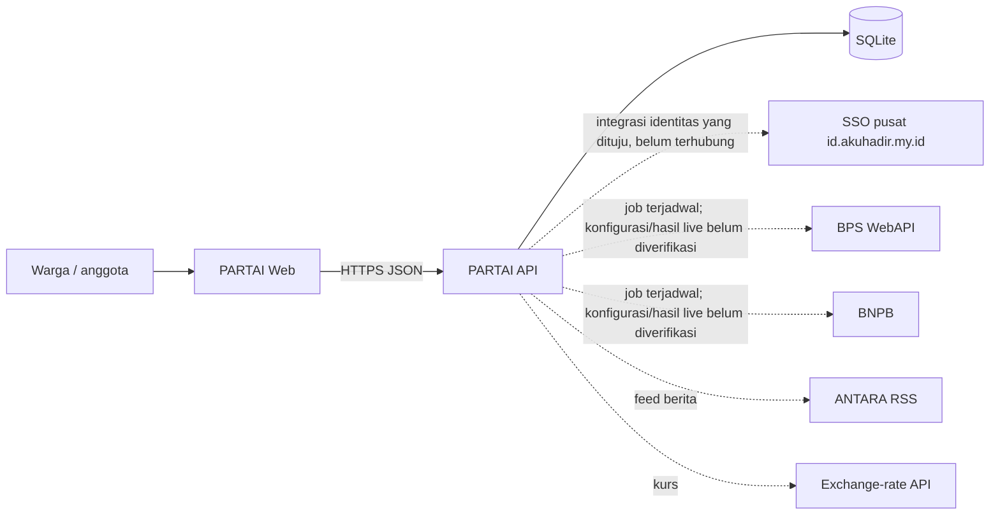
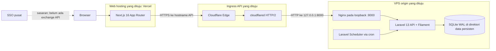
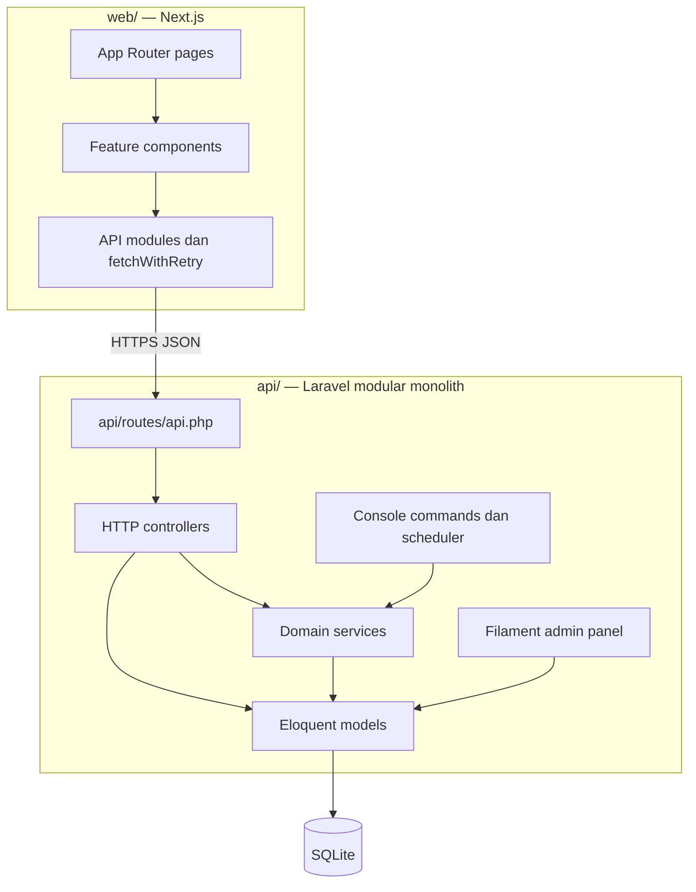
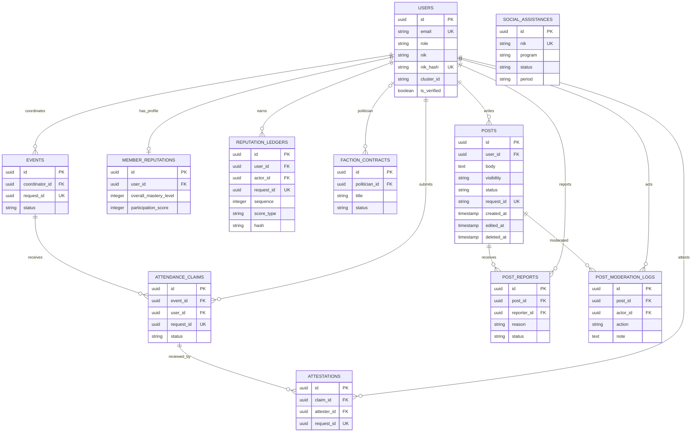

# Blueprint Arsitektur PARTAI

Dokumen ini adalah blueprint arsitektur kanonis untuk repository PARTAI. Ia memisahkan **implementasi yang terlihat di kode**, **topologi/prosedur yang dituju**, **roadmap**, dan **fakta operasional yang belum dapat dibuktikan dari repository**. Dokumen ini bukan bukti deployment, sertifikasi keamanan, atau kesiapan produksi.

Audit dokumentasi ini memakai commit `a8a501af36c0e56878655a671505ed3eafe64bb5` pada 19 November 2026. Tidak ada perubahan worktree sebelum audit; dokumen ini diperbarui berdasarkan audit repository pada commit tersebut. Jika dokumen ini bertentangan dengan kode, route, migrasi, test, atau workflow, sumber tersebut menang. Perubahan deployment yang hanya dideskripsikan di dokumen belum dianggap fakta runtime.

## Ruang lingkup dan sumber kebenaran

- **Web**: [`web/src/app/`](../web/src/app/), API client di [`web/src/lib/api/`](../web/src/lib/api/), manifest di [`web/package.json`](../web/package.json), dan konfigurasi [`web/next.config.ts`](../web/next.config.ts).
- **API**: route kanonis [`api/routes/api.php`](../api/routes/api.php), Laravel bootstrap [`api/bootstrap/app.php`](../api/bootstrap/app.php), controller/service di [`api/app/`](../api/app/), model dan migrasi di [`api/app/Models/`](../api/app/Models/) serta [`api/database/migrations/`](../api/database/migrations/).
- **Pengujian**: [`api/tests/`](../api/tests/), konfigurasi database pengujian [`api/phpunit.xml`](../api/phpunit.xml), dan tes browser [`web/tests/`](../web/tests/).
- **Operasi yang dimaksudkan**: [`docs/deployment.md`](deployment.md), [`docs/cloudflared-config.yml`](cloudflared-config.yml), [workflow deploy API](../.github/workflows/deploy-api.yml), [`api/deploy.sh`](../api/deploy.sh), dan [`web/vercel.json`](../web/vercel.json).
- **Kontrak serta roadmap**: [referensi API](api-reference.md), [kontrak ekosistem](../ECOSYSTEM.md), dan [ROADMAP.md](../ROADMAP.md).

Route API adalah sumber definitif untuk daftar endpoint. Referensi API dan panduan operasi adalah dokumen pendamping yang dapat tertinggal. Tidak ditemukan catatan ADR formal terpisah di repository; bagian keputusan di bawah adalah ringkasan pilihan yang tersirat oleh kode/config dan batas yang disepakati dokumen, bukan keputusan baru.

## Status bukti

| Label | Makna |
| --- | --- |
| **Ada di kode** | Implementasi, route, model, atau tes ditemukan pada commit yang diaudit. Tidak berarti sudah dipakai di production. |
| **Roadmap** | Belum tuntas menurut checkbox/status [ROADMAP.md](../ROADMAP.md). |
| **Ditentukan dokumen/config** | Ada konfigurasi atau instruksi deployment; tidak membuktikan server menjalankannya. |
| **Belum terverifikasi** | Repository tidak membuktikan konfigurasi live, data aktual, pemantauan, atau hasil operasional. |

Semua klaim “sudah di-deploy” memerlukan bukti eksternal (misalnya environment, status workflow, health check, atau konfirmasi operator) yang tidak tersedia dalam audit repository ini.

## Konteks sistem — C4 level 1

PARTAI terdiri atas browser/web, backend Laravel, database SQLite, dan sistem eksternal yang menjadi sumber data terjadwal. SSO pusat adalah authority yang dituju oleh kontrak ekosistem, tetapi alur autentikasi pada kode saat ini belum terhubung ke sana.

### Container/deployment — C4 level 2

Diagram ini menggambarkan topologi yang didefinisikan oleh konfigurasi/panduan, bukan hasil inspeksi host live.

[`docs/cloudflared-config.yml`](cloudflared-config.yml) menetapkan `protocol: http2` dan service `http://127.0.0.1:8000`. [`docs/deployment.md`](deployment.md) menjelaskan Nginx/PHP-FPM dan path SQLite produksi `/var/data/partai/database.sqlite`. Belum ada bukti repository yang memastikan binding firewall, service systemd, DNS, cron, backup terjadwal, atau host production benar-benar aktif.

### Komponen aplikasi — C4 level 3

## Tanggung jawab dan batas

| Komponen | Tanggung jawab | Batas / status |
| --- | --- | --- |
| `web/` | UI warga, route Next.js, feature components, API client TypeScript. `API_BASE_URL` berasal dari `NEXT_PUBLIC_API_URL`, default lokal ke `http://127.0.0.1:8000/api`. | Bukan sumber otorisasi. API tetap harus memeriksa autentikasi, role, dan kepemilikan. |
| `api/` | REST/JSON API, validasi, Sanctum bearer token, role middleware, aturan domain, Filament, migrasi, dan console commands. | Satu Laravel modular monolith; modul berbagi runtime/database, bukan microservice. |
| Cloudflare Tunnel | Ingress eksternal yang dituju ke origin lokal API; config menggunakan HTTP/2. | Uptime, DNS, firewall, dan konfigurasi Tunnel live belum diverifikasi. |
| SQLite | Relational store untuk akun, pendidikan, reputasi, event, tata kelola, serta dataset publik. | WAL memperbaiki pola concurrency pembaca, bukan menjadikan SQLite multi-writer atau tanpa lock. |
| SSO `id.akuhadir.my.id` | Authority identitas lintas aplikasi yang disebut dalam [`ECOSYSTEM.md`](../ECOSYSTEM.md). | Belum ditemukan token exchange/callback SSO di route/controller yang diaudit. |
| Integrasi data eksternal | BPS WebAPI, BNPB, ANTARA RSS, dan API kurs; sebagian pekerjaan dijalankan melalui command terjadwal. | Endpoint, kredensial, kelengkapan data, dan eksekusi jadwal live belum diverifikasi. |

## Route dan modul

### Route frontend

Route halaman yang ditemukan di `web/src/app/` meliputi:

| Area | Route |
| --- | --- |
| Beranda dan informasi | `/`, `/info`, `/info-indonesia`, `/data`, `/manifesto` |
| Pendidikan dan referensi | `/belajar`, `/review`, `/panduan`, `/glosarium` |
| Partisipasi | `/events`, `/events/[id]/qr`, `/events/[id]/claim`, `/events/[id]/attest` |
| Transparansi | `/jemput-hak`, `/kontrak-faksi`, `/pengawasan-birokrasi`, `/tanya-jawab` |
| Tata kelola | `/voting`, `/recall`, `/tata-kelola`, `/peta-jalan` |
| Akun | `/daftar`, `/masuk`, `/auth/register`, `/lupa-password`, `/reset-password`, `/profil`, `/notifikasi` |
| Reputasi | `/reputasi` |

Route `/juri-warga` dan `/info-indonesia` juga direwrite oleh [`web/next.config.ts`](../web/next.config.ts); rewrite bukan bukti route API atau kemampuan sortisi publik. Daftar halaman dapat ditelusuri di [`web/src/app/`](../web/src/app/).

### Domain API

Semua path API di bawah relatif terhadap prefix `/api`. Akses final dan middleware harus diperiksa pada [`api/routes/api.php`](../api/routes/api.php); daftar ini adalah peta domain, bukan spesifikasi payload lengkap.

| Domain | Endpoint utama di kode | Implementasi terkait |
| --- | --- | --- |
| Auth dan profil | `/auth/guest`, `/auth/register`, `/auth/login`, `/auth/logout`, `/auth/verify-email/{id}/{hash}`, `/auth/forgot-password`, `/auth/reset-password`, `/user` | `AuthController`, `SessionController`, `auth:sanctum`, Sanctum tokens |
| Kesejahteraan dan data | `/welfare/*`, `/welfare/ikk`, `/economic/*`, `/economy/*`, `/insights/*`, `/rights/check` | `WelfareController`, `WelfareIndexController`, `EconomicController`, `SocialAssistanceController` |
| Pendidikan | `/education/overview`, `/education/session`, `/education/answers`, `/review`, `/answer`, `/essay/*` | `CivicEducationService`, `ReviewController`, `EssayController` |
| Kegiatan | `/events`, `/events/active`, `/events/{id}/qr`, `/attendance/claim`, `/attendance/pending`, `/attendance/attest` | `EventController`, `AttendanceController`, `AttendanceService` |
| Reputasi dan tata kelola | `/reputation*`, `/reputation/contributions`, `/votes/*`, `/recall/*`, `/sortition/panels` | `ReputationService`, `VoteService`, controller domain terkait |
| Informasi organisasi | `/contracts`, `/faqs`, `/inquiries`, `/glossary`, `/organization/*`, `/finance/*`, `/bureaucracy/*`, `/notifications` | Controller/model per domain; cek middleware role dan rate limit pada route sumber |
| Komunitas | `/posts`, `/posts/members`, `/posts/{post}`, `/posts/{post}/report` | `PostController`, `PostReportController`, model `Post`/`PostReport`/`PostModerationLog`, panel moderasi Filament |

Panel administrasi Filament menggunakan path `/admin` dan guard web di [`api/app/Providers/Filament/AdminPanelProvider.php`](../api/app/Providers/Filament/AdminPanelProvider.php). Akses panel memerlukan salah satu role `super_admin`, `pengurus`, `panelis`; hak tiap resource dapat lebih sempit.

## Model data dan relasi inti

Diagram ini menyederhanakan migrasi/model. Field, constraint, dan aksi cascade yang persis berlaku ada di file migrasi.

`SocialAssistance` tidak memiliki foreign key ke `User`; API mencari berdasarkan NIK, lalu menguji bahwa NIK request sama dengan NIK akun. Hubungan tersebut adalah lookup berbasis nilai, bukan relasi Eloquent. Model inti tambahan mencakup `CivicQuestion`/jadwal soal, esai, voting/recall, data ekonomi/wilayah, laporan birokrasi, keuangan partai, dan pengajuan kursi organisasi; lihat migrasi di [`api/database/migrations/`](../api/database/migrations/).

Domain Komunitas menyimpan teks post saja dengan visibilitas `public` atau `members` (default `members`), status `published`, `hidden`, atau `deleted`, idempotensi `request_id`, dan soft delete. Feed publik membatasi hasil ke post publik berstatus published dan dapat memakai cache singkat; feed anggota hanya mengambil post anggota berstatus published dan mengirim `Cache-Control: no-store, private` serta `X-Robots-Tag: noindex, nofollow`. Konten post anggota tidak dipakai untuk metadata atau preview OG publik.

### Dua sistem reputasi

- `reputation_logs` dan atribut legacy `users.reputation_points` menyimpan poin reputasi lama untuk aktivitas seperti kuis/kehadiran.
- `member_reputations` dan `reputation_ledgers` memisahkan mastery per domain dari participation. [`ReputationService`](../api/app/Services/ReputationService.php) menghitung ulang skor/level; ledger memakai urutan dan hash berantai, dan model/migrasi menolak update/delete.
- Batas ini tidak membuktikan bahwa asesmen, sertifikasi, panel, atau seluruh alur kurasi sudah lengkap; lihat status pada [ROADMAP.md](../ROADMAP.md).

## Autentikasi, sesi, dan SSO

### Yang ada di kode saat ini

1. `/daftar` memanggil `POST /api/auth/register`; API memvalidasi email/password, membuat user dan Sanctum token, lalu mengirim email verifikasi ([`AuthController`](../api/app/Http/Controllers/Api/AuthController.php)).
2. `/masuk` memanggil `POST /api/auth/login`; [`SessionController`](../api/app/Http/Controllers/Api/SessionController.php) memeriksa email/password dan mengeluarkan token untuk akun non-guest. Login ini tidak meminta `request_id`.
3. Browser menyimpan bearer token sesi di [`web/src/lib/api/auth.ts`](../web/src/lib/api/auth.ts). Sesi tamu tersedia melalui `POST /api/auth/guest`. Request privat mengirim `Authorization: Bearer ...`; backend melindunginya dengan `auth:sanctum`.
4. Lupa/reset password tersedia dan memakai `IdempotentPasswordRequest`; verifikasi email memakai URL signed.
5. `/api/auth/logout` menghapus current Sanctum token. Ini bukan logout SSO.

### SSO pusat: sasaran dan gap

`id.akuhadir.my.id` dinyatakan sebagai authority yang dituju di [`ECOSYSTEM.md`](../ECOSYSTEM.md), tetapi tidak ditemukan callback, token exchange, JWKS/introspection, issuer/audience validator, atau route SSO pada [`api/routes/api.php`](../api/routes/api.php). Tidak ada dasar untuk menyatakan SSO end-to-end tersedia. README lama dan dokumen terkait yang menyatakan UI tidak memiliki login lokal juga bertentangan dengan halaman `/masuk` dan route `/api/auth/login` pada kode.

Sebelum migrasi ke SSO, kontrak perlu menentukan issuer, audience, signature/JWKS atau introspection, expiry, revocation/logout, pemetaan akun, dan transisi token Sanctum. Jangan mengirim password SSO ke PARTAI; jangan membuat endpoint/token SSO baru hanya berdasarkan asumsi dokumen.

## Otorisasi / RBAC

Ada dua konsep yang harus dibedakan:

- Kolom legacy `users.role` berisi nilai seperti `guest` atau `member`.
- Spatie `HasRoles` menyimpan role panel/API: `super_admin`, `pengurus`, `panelis` (dibuat oleh [`RoleSeeder`](../api/database/seeders/RoleSeeder.php)).

Rute privat umumnya memakai `auth:sanctum`; kelompok tertentu menambah middleware `role:`. Contoh pada route API: penulisan kontrak/Ikk dibatasi ke `super_admin|pengurus`; kontribusi reputasi ke `super_admin|pengurus|panelis`; pemeriksaan bansos memerlukan token, NIK yang telah diverifikasi, dan kecocokan kepemilikan NIK. Verifikasi tersebut memerlukan cap waktu `users.nik_verified_at` yang ditetapkan oleh admin `super_admin` melalui toggle di editor user pada resource Filament [`UserResource`](../api/app/Filament/Resources/UserResource.php). NIK tanpa cap tersebut belum dianggap terverifikasi; UI menyembunyikan kontrol bukan pengganti pemeriksaan server.

Endpoint baca publik tidak otomatis berarti seluruh data di domain itu bersifat publik. Periksa controller, serialisasi, data yang dipublikasikan, cache, dan otorisasi sebelum menambah field.

## Kontrak API, idempotensi, dan retry

### Pola umum yang harus diikuti

- API memakai prefix `/api`, JSON, dan HTTPS pada host produksi yang dituju `api.akuhadir.my.id`.
- Operasi tulis bisnis yang mendukung idempotensi menerima UUID `request_id` dari client. Satu operasi logis mempertahankan ID dan payload yang sama saat retry.
- Implementasi tertentu menyimpan respons untuk replay identik; pemakaian ulang ID untuk endpoint/payload/pemilik/objek berbeda ditolak dengan HTTP `409`.
- Validasi Laravel umumnya menghasilkan `422`; autentikasi/otorisasi masing-masing `401`/`403`; rate limit menghasilkan `429`. Detail status harus dilihat per endpoint/controller, tidak semua error diseragamkan.
- Batas request ditetapkan pada route secara eksplisit, misalnya guest `300/menit`, login/register `10/menit`, reset password `5/menit`, IKK publik `60/menit`, IKK ingest `20/menit`, dan beberapa mutasi kegiatan `10–30/menit`. Ini bukan bukti ada rate limit global yang sama untuk semua endpoint.
- Mutasi autentikasi tertentu (`/auth/login`, `/auth/logout`) tidak memakai `request_id`; jangan menyebut semua HTTP POST memiliki kontrak idempotensi identik.

Tabel `api_idempotency_keys` bersama middleware [`IdempotentPasswordRequest`](../api/app/Http/Middleware/IdempotentPasswordRequest.php) menyimpan hash payload dan respons untuk forgot/reset password. Fitur lain mengimplementasikan replay pada service/tabel domain, misalnya [`AttendanceService`](../api/app/Services/AttendanceService.php), [`VoteService`](../api/app/Services/VoteService.php), dan [`ReputationService`](../api/app/Services/ReputationService.php). Detail mutasi kontrak/notifikasi juga memiliki tes di [`MutationIdempotencyTest.php`](../api/tests/Feature/MutationIdempotencyTest.php).

### Helper frontend

[`fetchWithRetry`](../web/src/lib/api/client.ts) mencoba ulang sampai dua kali setelah `TypeError` dari `fetch`, dengan jeda 1.500 ms. Helper tersebut tidak mengulang response HTTP gagal (misalnya 500) dan tidak otomatis menilai body/status sebagai sukses; pemanggil harus memeriksa `response.ok`. Karena helper juga dipakai pada POST, mutasi yang diulang harus mengirim `request_id` dan body yang sama. Jangan membuat ID baru untuk retry operasi yang sama.

Tidak semua endpoint menerapkan pola replay yang sama. Sebelum menambah pemanggilan mutasi, verifikasi validator, penyimpanan idempotensi, perlakuan `409`, rate limit, dan test spesifik pada controller/route-nya. Referensi ringkas: [`docs/api-reference.md`](api-reference.md).

## Integrasi data eksternal dan scheduler

Kode memiliki integrasi/adapter untuk:

- BPS WebAPI melalui `BPS_API_*` dan service/command di `api/app/Services/BpsApiService.php` serta `api/app/Console/Commands/`.
- BNPB, termasuk ArcGIS dan konfigurasi CKAN opsional `BNPB_CKAN_*`.
- ANTARA RSS untuk berita dan `open.er-api.com` untuk kurs melalui command terjadwal.
- IKK menghitung komposit indikator yang ditetapkan di [`WelfareIndexService.php`](../api/app/Services/WelfareIndexService.php); pipeline dapat memakai baseline offline bila sumber tidak tersedia.

[`api/routes/console.php`](../api/routes/console.php) menjadwalkan data BPS/BNPB, berita, kurs, dan digest. Laravel Scheduler perlu dipanggil oleh cron agar berjalan; konfigurasi cron di [`docs/deployment.md`](deployment.md) adalah instruksi, bukan bukti cron aktif. Beberapa command/fallback mengisi data simulasi/curated. Keberadaan adaptor atau job tidak membuktikan API eksternal bisa diakses, API key valid, data aktual/terbaru, atau hasil cocok untuk keputusan publik.

## Deployment, rilis, dan status operasional

### Yang didefinisikan di repository

- Workflow [`deploy-api.yml`](../.github/workflows/deploy-api.yml) berjalan pada push ke `main` jika path `api/**` atau file workflow berubah; ia membuka SSH menggunakan `SSH_HOST`, `SSH_USER`, `SSH_KEY`, lalu menjalankan `bash api/deploy.sh`.
- [`api/deploy.sh`](../api/deploy.sh) melakukan `git fetch origin`, `git reset --hard origin/main`, `composer install --no-dev`, `php artisan migrate --force`, clear/cache Laravel, beberapa sinkronisasi data, dan reload `php8.4-fpm`.
- [`web/vercel.json`](../web/vercel.json) memiliki konfigurasi region `sin1` dan header CORS untuk path `/api/*`; ini tidak membuktikan proyek Vercel telah dihubungkan/deploy.
- [`docs/cloudflared-config.yml`](cloudflared-config.yml) menyatakan ingress API hostname melalui Tunnel ke loopback.
- [`docs/deployment.md`](deployment.md) menyebut API di VPS, web di Vercel, Nginx/PHP-FPM, dan SQLite persisten di `/var/data/partai/database.sqlite`.

### Konflik panduan dan risiko rilis

[`docs/github-actions.md`](github-actions.md) tidak konsisten dengan file executable yang diaudit: panduan menyebut user/path deployment dan `php8.3-fpm`, sedangkan workflow mengandalkan secret `SSH_USER`, skrip mengasumsikan `/var/www/thortech/partai`, dan skrip me-reload `php8.4-fpm`. [`docs/deployment.md`](deployment.md) juga perlu dibandingkan dengan nilai host/user/path yang benar-benar dipakai operator. Jangan gunakan instruksi yang bertentangan sebelum dikonfirmasi dan direkonsiliasi.

`git reset --hard origin/main` pada `api/deploy.sh` membuang perubahan lokal di checkout server. Workflow tidak menunjukkan tahap tes, persetujuan manual, health check pasca deploy, atau prosedur rollback. `migrate --force` dapat mengubah skema sebelum rilis berhasil. Perlakukan deploy sebagai perubahan berisiko; operator harus mengonfirmasi checkout server, backup, kompatibilitas migrasi, service, dan kesiapan rollback. Jangan menjalankan workflow/skrip hanya karena dokumentasinya ada.

Status Vercel, VPS, DNS, Tunnel, SSH secrets, hasil workflow terakhir, CORS efektif, scheduler/cron, dan kesehatan production **belum terverifikasi** dari commit ini.

## SQLite, migrasi, backup, dan restore

- [`api/config/database.php`](../api/config/database.php) memakai SQLite sebagai konfigurasi default; deployment guide menentukan file produksi `/var/data/partai/database.sqlite` di luar working tree.
- [`AppServiceProvider`](../api/app/Providers/AppServiceProvider.php) menetapkan `journal_mode=WAL`, `synchronous=NORMAL`, `busy_timeout=5000`, `foreign_keys=ON`, `temp_store=MEMORY`, dan `cache_size=-20000`.
- WAL membuat pembaca dapat berjalan bersamaan dengan writer, tetapi penulisan tetap terserialisasi. `busy_timeout=5000` membatasi waktu menunggu lock; tetap ada kemungkinan operasi gagal saat lock berkepanjangan atau ruang disk habis. Belum ada bukti failover database otomatis.
- Workflow menjalankan migrasi paksa. Buat backup konsisten sebelum migrasi atau deploy berisiko dan cek migrasi baru untuk operasi destruktif.
- [`docs/deployment.md`](deployment.md) menyarankan SQLite Online Backup (`sqlite3 <db> ".backup <file>"`) sebelum menyalin file. Saat database aktif, jangan menyalin file `.sqlite` saja karena transaksi bisa masih berada di `-wal`/`-shm`.
- Tidak ditemukan skrip backup terjadwal, kebijakan retensi, enkripsi backup, uji restore berkala, atau recovery-time/recovery-point objective di repository. Prosedur pemulihan database produksi harus disepakati operator; restore belum dapat diverifikasi.

### Alur migrasi/rollback

Migrasi berada di `api/database/migrations/`; deploy script menjalankan `php artisan migrate --force`. Tidak ada langkah rollback aplikasi/database otomatis yang didefinisikan di workflow. Jika deployment gagal setelah migrasi, mengembalikan source code saja belum tentu membalikkan skema atau data. Gunakan migrasi maju yang kompatibel, backup teruji, dan rencana pemulihan yang ditinjau sebelum rilis.

## Failure modes dan observability

| Kegagalan | Perilaku/bukti yang tersedia | Batas dan tindakan operasional |
| --- | --- | --- |
| API BPS/BNPB/berita/kurs gagal | Beberapa command memakai timeout/retry terbatas dan melaporkan error/warning; pipeline IKK dapat menggunakan baseline offline. | Baseline bukan data live. Pantau log/status command dan jangan tampilkan fallback sebagai data terverifikasi. |
| SQLite terkunci / storage penuh | SQLite memakai WAL dan busy timeout 5 detik. | Tidak ada failover DB yang tampak. Pastikan kapasitas disk dan pantau exception; backup/checkpoint harus mengikuti prosedur SQLite. |
| Tunnel atau origin down | Akses API publik melewati Tunnel/origin sesuai konfigurasi. | Request web akan gagal; health check dan alert eksternal belum ditemukan. Periksa Tunnel, proxy, PHP-FPM, dan `/up`. |
| Deploy gagal | Shell script `set -euo pipefail`; sebagian sync data sengaja hanya memberi warning, sementara kegagalan langkah lain menghentikan script. | Tidak tampak deployment rollback otomatis atau smoke test setelah reload. Periksa workflow logs dan kondisi database/service sebelum retry. |
| Email/reset gagal | Auth memakai mailer Laravel dan notification flow. | Mail transport produksi belum dapat diverifikasi; jangan mengasumsikan email terkirim hanya dari route yang ada. |

Laravel mendaftarkan health route `/up` melalui [`bootstrap/app.php`](../api/bootstrap/app.php). Logging memakai konfigurasi [`api/config/logging.php`](../api/config/logging.php), dengan default `LOG_CHANNEL=stack`, `LOG_STACK=single` di [`.env.example`](../api/.env.example); log file berada di `api/storage/logs/` pada konfigurasi standar. Tidak ditemukan konfigurasi metrik, tracing, dashboard alert, atau retensi log terpusat di repository; status tersebut **belum terverifikasi** di host.

## Keamanan dan privasi

### Rahasia dan token

- Jangan commit `.env`, `APP_KEY`, API key BPS/BNPB, SSH key, Tunnel credentials, bearer token, atau backup.
- Nilai `NEXT_PUBLIC_*` dapat diakses dari browser; jangan letakkan secret di sana.
- API memakai bearer Sanctum token untuk route privat. Frontend saat ini menyimpan token sesi di `localStorage`; ini meningkatkan dampak XSS dan tidak sama dengan cookie sesi SSO terpusat.
- Set produksi minimal perlu `APP_DEBUG=false` dan secret injection yang dikelola operator; ini adalah kebutuhan operasi, bukan status host yang sudah dibuktikan.

### NIK dan data pribadi — risiko nyata pada kode

- `User::nik` memakai encrypted cast dan model menyembunyikan atribut itu dari serialisasi; migrasi [`encrypt_user_nik`](../api/database/migrations/2026_11_18_000000_encrypt_user_nik.php) menyimpan `nik_hash` untuk pencocokan.
- Verifikasi NIK merupakan status terpisah dari keberadaan/enkripsi nilainya: `users.nik_verified_at` berisi cap waktu yang ditetapkan atau dihapus oleh `super_admin` di Filament. Nilai `NULL` berarti akun belum diverifikasi dan pemeriksaan bansos ditolak.
- Berbeda dari tabel `users`, migrasi [`create_social_assistances_table`](../api/database/migrations/2026_11_17_060000_create_social_assistances_table.php) mendefinisikan `social_assistances.nik` sebagai string biasa dan model tidak mendeklarasikan cast enkripsi. Seeder [`SocialAssistanceSeeder`](../api/database/seeders/SocialAssistanceSeeder.php) berisi NIK simulasi; jangan menaruh NIK nyata ke fixture atau seeder.
- `GET /api/rights/check` mengambil NIK secara implisit dari user yang terautentikasi dan tidak mengirim NIK pada URL ([route](../api/routes/api.php), [`SocialAssistanceController`](../api/app/Http/Controllers/Api/SocialAssistanceController.php)). Controller mensyaratkan NIK akun diverifikasi oleh admin (`nik_verified_at`) dan mengirim `Cache-Control: no-store, private`.
- Karena itu, klaim “NIK terenkripsi di database” hanya benar untuk atribut user yang diproses model/migrasi, bukan untuk seluruh tabel/jejak request. Jangan menggunakan dataset identitas nyata sebelum model penyimpanan, minimisasi, akses, retensi, dan logging ditinjau.
- Klaim lokasi event (lat/lng), kehadiran, laporan, email, dan jawaban esai juga dapat menjadi data pribadi/sensitif. Batasi akses dan isi fixture dengan data sintetis.

### Audit trail dan batasnya

Reputation ledger dirancang append-only melalui guard model dan trigger SQLite, dengan hash rantai untuk deteksi perubahan berdasarkan implementasi service. Ini tidak otomatis menjadi bukti audit independen, immutable storage, atau backup tahan manipulasi. Entitas lain harus diperiksa terpisah sebelum disebut memiliki audit trail yang sama.

## Tes dan verifikasi

- API menggunakan PHPUnit/Laravel test dan `RefreshDatabase`; [`api/phpunit.xml`](../api/phpunit.xml) mengatur SQLite `:memory:`, cache/session array, dan mail array untuk pengujian.
- Tes fitur mencakup auth, akses Filament, privasi NIK, data welfare, dan idempotensi. Contoh: [`EncryptedNikTest.php`](../api/tests/Feature/EncryptedNikTest.php) dan [`MutationIdempotencyTest.php`](../api/tests/Feature/MutationIdempotencyTest.php).
- Web menyediakan lint/build scripts dan Playwright `test:e2e` di [`web/package.json`](../web/package.json); tes e2e ada di [`web/tests/`](../web/tests/).
- Keberadaan tes bukan status kelulusan; hasilnya harus dicatat dari run yang aktual. Tes, Pint, lint, dan build tidak dijalankan dalam audit dokumentasi ini.

## Known gaps dan risiko

1. **SSO belum terintegrasi**: kontrak pusat ada, tetapi implementasi lokal guest/register/login/reset memakai Sanctum; belum ada SSO exchange/validator yang terlihat.
2. **Privasi NIK tidak seragam**: `users.nik` terenkripsi, sedangkan NIK dataset bansos tersimpan plain text; NIK juga dikirim pada path URL.
3. **Deployment tidak terbukti**: file workflow/config tersedia, tetapi status host, secrets, Tunnel, Vercel, cron, dan hasil rilis belum diperiksa.
4. **Panduan deployment bertentangan**: `docs/github-actions.md`, `docs/deployment.md`, workflow, dan skrip deploy memiliki perbedaan nilai/path/service; skrip melakukan `git reset --hard`.
5. **Tidak ada rencana recovery teruji**: tidak ditemukan automated backup, retensi, restore test, atau rollback migrasi/rilis.
6. **Kualitas/kemutakhiran data eksternal belum dijamin**: fallback offline/mock bisa berbeda dari data otoritatif; job terjadwal tidak membuktikan data berhasil diperbarui.
7. **Referensi API berpotensi tertinggal**: `api/routes/api.php` memuat login, verify-email, finance, organization, dan bureaucracy routes yang perlu dibandingkan terhadap tabel dokumentasi API.
8. **Skala dan ketersediaan belum dibuktikan**: SQLite/Single VPS adalah pilihan footprint rendah, bukan bukti kapasitas tertentu atau jaminan availability.
9. **Roadmap tata kelola**: sortisi ber-seed publik, panel tertentu, kurikulum/sertifikasi, dan fitur lainnya memiliki status yang dinyatakan di [ROADMAP.md](../ROADMAP.md); jangan promosikan sebagai lengkap sebelum statusnya berubah dengan bukti.

## Keputusan arsitektur (ringkasan, bukan ADR formal)

| Keputusan yang tercermin | Alasan/petunjuk di repo | Trade-off / konsekuensi |
| --- | --- | --- |
| Laravel modular monolith | Satu aplikasi, route/controller/service/migrasi bersama. | Lebih sederhana dioperasikan; semua domain berbagi proses dan database. |
| SQLite WAL persisten | `AppServiceProvider`, config SQLite, deployment guide. | Sedikit komponen operasi; writer tetap serial dan kapasitas harus diuji. |
| Tunnel sebagai ingress API | `docs/cloudflared-config.yml` meneruskan ke `127.0.0.1:8000`. | API origin tidak perlu dipublikasikan langsung; ketersediaan Tunnel menjadi dependensi. |
| Idempotency per operasi tulis | `request_id`, constraint unik, replay logic, serta test fitur. | Harus diterapkan endpoint demi endpoint; klien wajib mempertahankan payload dan ID saat retry. |
| SSO pusat sebagai arah identitas | Kontrak di `ECOSYSTEM.md`; belum ada exchange implementasi. | Migrasi autentikasi harus menunggu kontrak issuer/audience/token yang tervalidasi. |
| Mastery dan participation terpisah | Model/service dan ledger reputasi Fase 2. | Memisahkan kapasitas dari kontribusi; interpretasi kelayakan dan proses tata kelola tetap perlu audit. |

Perubahan yang mengubah batas jaringan, database, identitas, atau format API sebaiknya menjadi ADR formal dan diperbarui di blueprint ini, `ECOSYSTEM.md`, serta [referensi API](api-reference.md).
