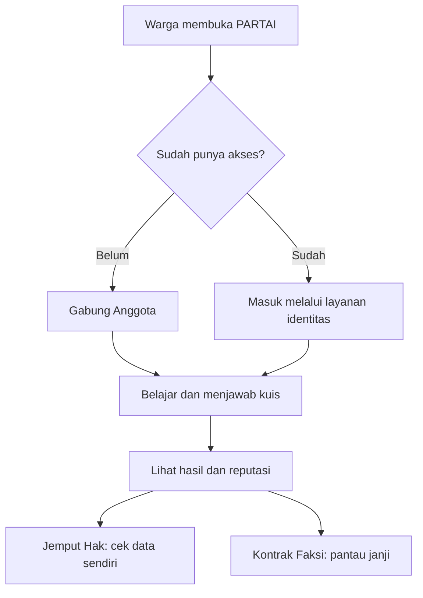

# Panduan Warga PARTAI

Panduan ini menjelaskan cara menggunakan fitur warga di akuhadir.my.id. Gunakan data diri sendiri dan pahami bahwa informasi bantuan yang tampil bergantung pada data yang tersedia—hasil aplikasi bukan keputusan resmi penyaluran.

## Memulai dan bergabung

1. Buka [akuhadir.my.id](https://akuhadir.my.id).
2. Pilih **Gabung Anggota** untuk membuka formulir pendaftaran.
3. Isi nama lengkap, email, password minimal 8 karakter, dan pilih wilayah. NIK bersifat opsional saat mendaftar; masukkan hanya bila memang diperlukan untuk menggunakan pemeriksaan bantuan atas data sendiri.
4. Pilih **Daftar sebagai Anggota**. Jika berhasil, aplikasi membawa Anda ke profil.
5. Untuk tautan **Masuk**, aplikasi membuka layanan identitas pusat Aku Hadir. Ikuti petunjuk di layanan tersebut.

**Catatan akun:** halaman pendaftaran anggota saat ini menggunakan endpoint pendaftaran API, sedangkan standar arsitektur menetapkan SSO terpusat di `id.akuhadir.my.id`. Penyelarasan alur token masih merupakan pekerjaan teknis; jangan menganggap semua sesi pendaftaran lama sudah ditautkan otomatis ke SSO. Jangan membagikan password, token, atau NIK kepada orang lain.

## Belajar dan mengumpulkan reputasi

1. Pilih menu **Belajar** untuk membuka sesi kuis.
2. Baca pertanyaan, pilih jawaban, lalu kirim. Setelah jawaban tersimpan, hasil benar/salah dan pembahasan akan ditampilkan.
3. Jika muncul soal esai, tulis jawaban dengan kata-kata sendiri dan kirim untuk masuk antrean penilaian. Pembahasan ditampilkan setelah esai dikirim; penilaian dilakukan oleh warga lain sesuai mekanisme peer review.
4. Jawab dengan benar untuk mendapatkan poin reputasi. Implementasi saat ini memberi 10 poin untuk jawaban kuis benar; esai dengan skor peer review minimal 70 dapat memberi 50 poin. Anda dapat melihat reputasi dan riwayatnya di **Profil**.
5. Kembali belajar secara berkala. Sistem pengulangan terjadwal dapat menampilkan lagi soal yang sudah waktunya ditinjau.

Jangan mengirim jawaban orang lain sebagai karya sendiri atau menilai esai sendiri. Jumlah dan aturan poin dapat berubah; riwayat profil adalah rujukan untuk catatan akun Anda.

## Menggunakan “Jemput Hak”

1. Buka menu **Transparansi Data → Jemput Hak**.
2. Masukkan 16 digit NIK yang terdaftar pada akun Anda sendiri. Layanan menolak pemeriksaan NIK orang lain.
3. Pilih **Cek Sekarang** dan baca nama program (PKH, BPNT, atau PIP), status, dan periode yang ditampilkan.
4. Jika data tidak ditemukan atau Anda merasa berhak tetapi belum tercatat, hubungi pengurus/instansi yang berwenang untuk pemeriksaan lanjutan.

Gunakan layanan secukupnya; endpoint membatasi percobaan. NIK tidak boleh ditempelkan ke ruang publik. Status di aplikasi bukan persetujuan, penolakan, atau keputusan resmi pemerintah.

## Memantau “Kontrak Faksi”

1. Buka menu **Transparansi Data → Kontrak Faksi**.
2. Baca nama, judul janji, uraian, status, dan tenggat setiap kontrak.
3. Gunakan filter status untuk melihat janji yang **Belum dimulai**, **Sedang berjalan**, **Terpenuhi**, atau **Gagal**.
4. Jika bukti tersedia, pilih **Lihat Bukti** untuk membukanya di tab baru.

Daftar ini membantu warga memantau catatan janji yang tersedia; status dan bukti yang belum dipublikasikan tidak dapat diasumsikan. Saat ini tampilan publik adalah untuk membaca dan memfilter, bukan mengubah kontrak.

## Alur singkat

## Jika mengalami kendala

- Jika pendaftaran gagal, periksa kembali email, wilayah, dan panjang password, lalu coba lagi.
- Jika layanan sedang terganggu, gunakan tombol coba lagi atau kembali beberapa saat kemudian. Jangan mengirim berulang kali dengan data berbeda setelah suatu permintaan tertunda.
- Jika status bantuan atau kontrak tidak tersedia, bisa jadi data belum dimasukkan atau belum diperbarui.
- Jangan mengirim kredensial, NIK lengkap, atau tangkapan layar berisi data pribadi melalui issue publik. Hubungi pengelola secara privat.
